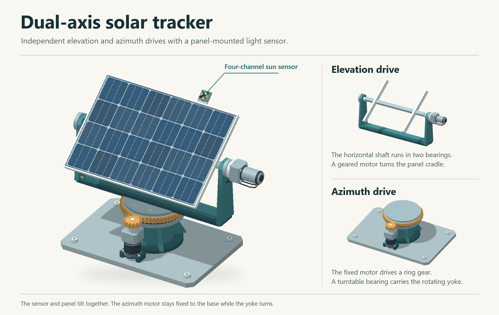
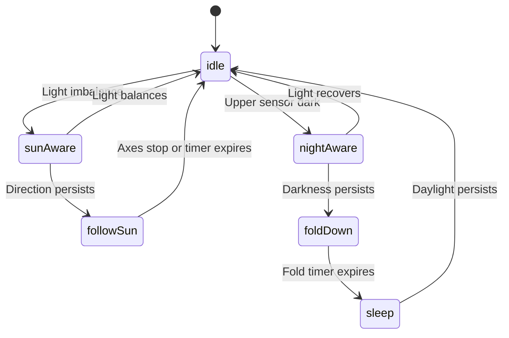
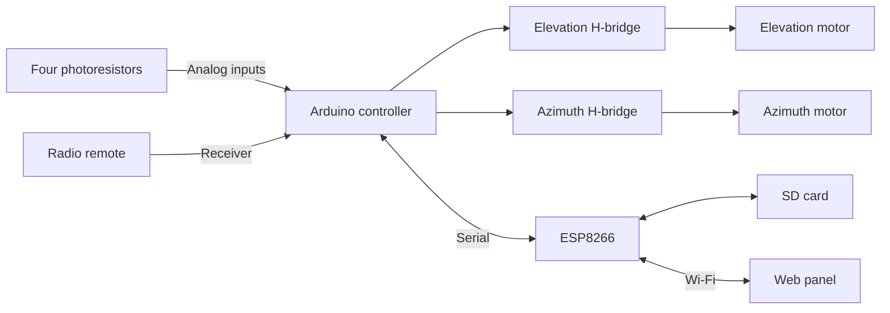
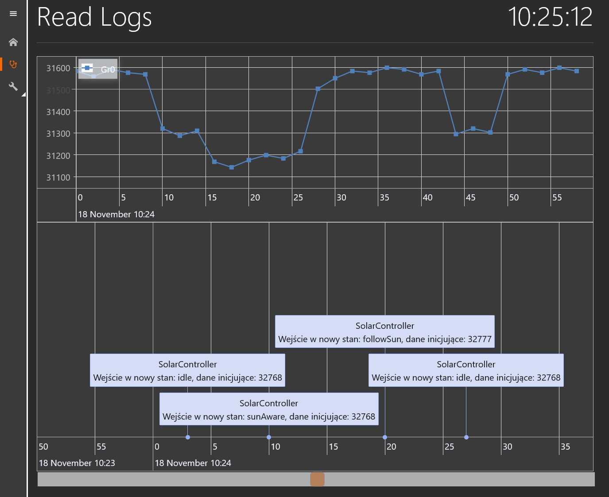

# Dual-Axis Solar Tracker

An Arduino controller points a solar panel toward the brightest part of the sky. It compares four photoresistors and drives the elevation and azimuth motors independently. A radio remote provides manual control, and an ESP8266 serves a browser panel for inspecting device logs and setting the clock.

[Hardware drawings](docs/hardware.md) · [Web panel and tracking session](docs/interface.md) · [Main Arduino sketch](Sterownik_Solarny/Sterownik_Solarny.ino)

*Assembly drawing showing the elevation shaft that tilts the panel and the azimuth turntable that rotates its base.*

## One tracking cycle

1. **Measure.** The controller compares the top and bottom photoresistors for elevation, and the right and left photoresistors for azimuth. Each axis has a stored calibration offset.
2. **Confirm the direction.** An imbalance above the sensitivity threshold moves the controller from `idle` to `sunAware`. The direction must persist for the configured delay. A change of direction restarts the timer, which helps the tracker ignore a passing shadow.
3. **Move and settle.** In `followSun`, each H-bridge drives its motor in the required direction using PWM. Each axis stops independently as its error closes or changes sign. The controller returns to idle when both axes stop or the 30-second movement timer expires.

The threshold and delay are configurable. The firmware’s fallback settings use a sensitivity of 30 ADC counts and a 10-second confirmation delay. [Light sensor](libraries/SunSensor/SunSensor.cpp) · [Controller state machine](libraries/SolarController/SolarController.cpp)

The diagram follows automatic operation. Sustained darkness starts a timed fold-down sequence. In sleep, both bridges are off while the controller checks for daylight. The radio remote can switch modes and jog either axis manually. [Radio control](libraries/RemoteController/RemoteController.cpp)

## Hardware and firmware

The main sketch assigns the four analog inputs and both H-bridges. It also connects a radio receiver and a PCF8574 I/O expander for the indicator and Wi-Fi enable signal. The hardware gallery includes the complete assembly, the directional sensor head and the two motor circuits. [Hardware drawings and pin map](docs/hardware.md)

## Web diagnostics

The **Read Logs** panel plots a selected numeric channel above a timeline of firmware events. The upper graph shows free ESP8266 heap in bytes. The four entries below it follow a single correction from idle to motor movement and back. The original interface uses English controls and Polish event descriptions.

The **Set Time** view provides date and time pickers at phone width. Both captures use the project’s original web assets and show the same date, 18 November 2026. [Mobile view and session data](docs/interface.md)

## Source guide

| Area | Entry point |
| --- | --- |
| Main Arduino firmware | [Tracker sketch](Sterownik_Solarny/Sterownik_Solarny.ino) |
| ESP8266 service, time setting and web assets | [ESP8266 sketch](Test_WiFiModuleESP/Test_WiFiModuleESP.ino) · [WiFiModuleESP](libraries/WiFiModuleESP) |
| Optical feedback and EEPROM calibration | [SunSensor](libraries/SunSensor/SunSensor.cpp) |
| Motor control and operating modes | [SolarController](libraries/SolarController/SolarController.cpp) |
| Radio input from a PC serial port | [RemoteControllerPC sketch](RemoteControllerPC/RemoteControllerPC.ino) |
| Component exercises | [Sun sensor](Test_SunSensor/Test_SunSensor.ino) · [Indicator](Test_LedIndicator/Test_LedIndicator.ino) · [Remote](Test_RemoteController/Test_RemoteController.ino) · [Serial test peer](Test2_WiFiModuleESP/Test2_WiFiModuleESP.ino) |

The `v1`, `v2` and `Backup` directories preserve project variants. The links above point to the implementations used by the main sketches. Shared Arduino libraries such as `BridgeH`, `RadioListener`, `SerialListener` and `UpdateManager` are external dependencies.
