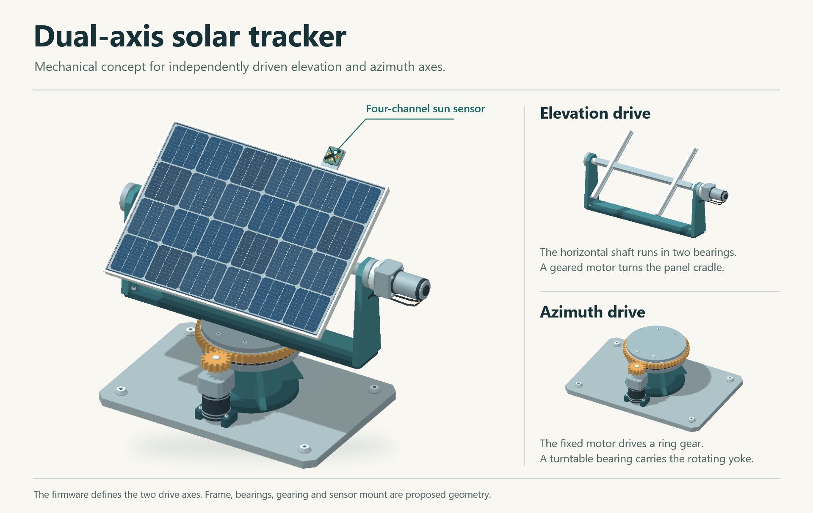
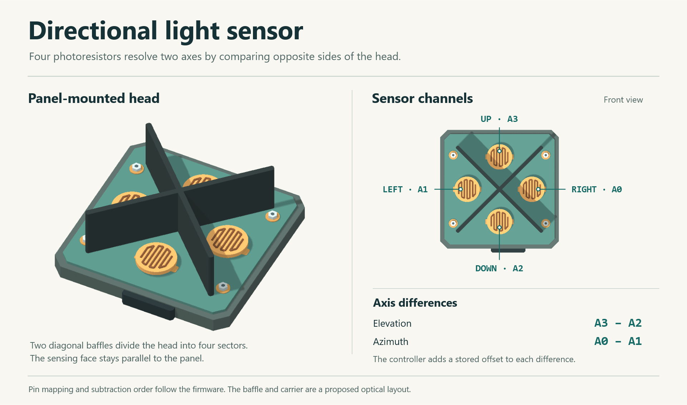
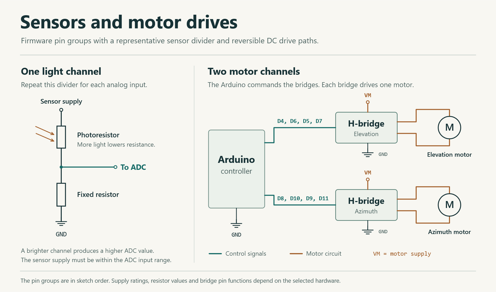

# Hardware drawings

The firmware defines the four sensor channels, two motor axes and their Arduino pins. These drawings show one mechanical and electrical arrangement consistent with those interfaces. [Main sketch](../Sterownik_Solarny/Sterownik_Solarny.ino) · [Project overview](../README.md)

## Tracker assembly

In this concept, the panel and light sensor tilt together on a horizontal shaft supported by two bearings. The elevation gearmotor is mounted to the rotating yoke. At the base, a stationary motor drives a ring gear while a turntable bearing carries the yoke. The frame, bearings, gearing and mount geometry are proposed for this illustration.

## Directional light sensor

The proposed head sits along the upper edge with its sensing face parallel to the panel. Two opaque diagonal baffles cast different shadows as light moves off-axis. The default orientation in the main sketch gives the following mapping.

| Axis | Positive side | Opposite side | Difference before calibration |
| --- | --- | --- | --- |
| Elevation | Upper · `A3` | Lower · `A2` | `A3 − A2` |
| Azimuth | Right · `A0` | Left · `A1` | `A0 − A1` |

The sensor code adds a stored offset to each difference and supports filtering for changes in the readings. [Sensor implementation](../libraries/SunSensor/SunSensor.cpp)

## Sensors and motor drives

The representative divider places the photoresistor above the analog input and a fixed resistor between the input and ground. More light then raises the input voltage, consistent with the firmware’s low-light check. Each motor has a separate reversible H-bridge channel.

| Function | Pins in sketch order |
| --- | --- |
| Elevation bridge | `D4`, `D6`, `D5`, `D7` |
| Azimuth bridge | `D8`, `D10`, `D9`, `D11` |
| Radio receiver interrupt | `D3` |

The motor supply is labelled **VM**. Driver terminal assignments, supply ratings and component values depend on the selected hardware. [Motor and sensor assignments](../Sterownik_Solarny/Sterownik_Solarny.ino)
