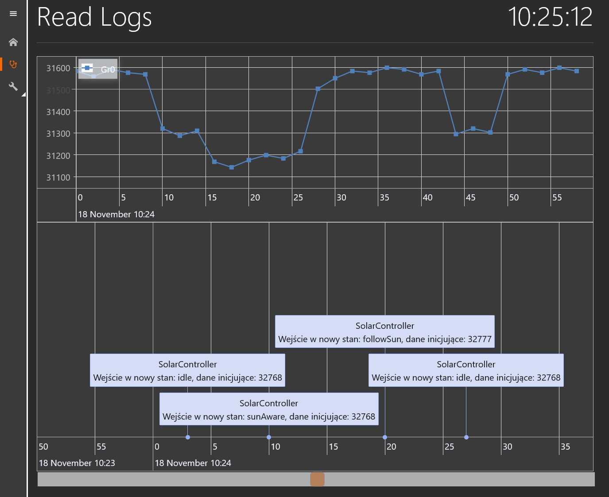
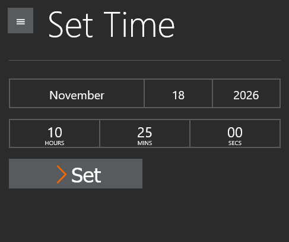

# Web panel

The ESP8266 serves a Metro UI interface with a log reader and a date/time form. These browser captures use the HTML, scripts, styles and icon font shipped with the project. [Original web assets](../libraries/WiFiModuleESP/Assets) · [Project overview](../README.md)

## Read Logs

The graph covers **10:24–10:25 on 18 November 2026**. Its horizontal axis is local device time and its vertical axis is free ESP8266 heap in bytes. The graph plots 30 free-heap readings at two-second intervals, ranging from **31,144 to 31,600 bytes**. The firmware alternates its free-heap and loop-duration channels. [ESP8266 logger](../libraries/WiFiModuleESP/WiFiModuleESP.cpp) · [Session data](tracking-session.json)

The timeline is zoomed around the correction. The firmware’s original Polish labels identify the state and its initialization word.

| Device time | State | Interpretation |
| --- | --- | --- |
| 10:24:03 | `idle` | The motors are off and the controller is sampling light. |
| 10:24:10 | `sunAware` | The light difference exceeds the threshold. The confirmation delay starts. |
| 10:24:20 | `followSun` | The direction has held for ten seconds. The controller starts the selected axes. |
| 10:24:27 | `idle` | The correction has ended and the controller resumes monitoring. |

The graph and timeline were drawn by the original log client using the event definitions bundled in the page. [Read Logs markup and event definitions](../libraries/WiFiModuleESP/Assets/ReadLogsBody.html) · [Log decoder](../libraries/WiFiModuleESP/Assets/LoggerClient/LoggerClient.js)

## Set Time on a phone

The date and time controls are set to the end of the interval shown on the graph. On the device, the **Set** button sends the selected values to the ESP8266 time-setting handler. [Set Time form](../libraries/WiFiModuleESP/Assets/SetTimeBody.html)

Home and Storage also appear in the menu. Neither view contains device controls.
